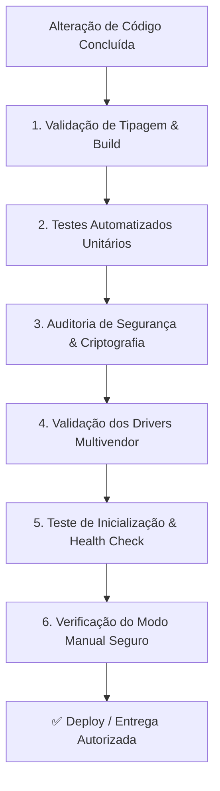

# Protocolo Obrigatório de Testes e Validação Contínua (NetPulse)

> **Regra Mandatória:** Este documento define o procedimento padrão de verificação e checagem de qualidade que deve ser **obrigatoriamente executado** pelo assistente e pelos desenvolvedores após **qualquer alteração, atualização, correção de bug ou nova funcionalidade** no código do NetPulse.

---

## 📋 Resumo Executivo das Etapas de Teste

Toda atualização deve passar com **100% de sucesso (ZERO erros)** nos seguintes pilares:



---

## 1. Compilação e Integridade de Tipos (Build Safety)

### Frontend (React + TypeScript + Vite)
- **Diretório:** `frontend/`
- **Comando Obrigatório:**
  ```powershell
  cd frontend
  npm run build
  ```
  *(Equivale a `tsc -b && vite build`)*
- **O que verificar:**
  - [ ] Nenhuma interface TypeScript (`api.ts` ou componentes) possui tipo quebrado ou ausente (`TS2339`, `TS2322`, `TS6133`).
  - [ ] O bundle é gerado com sucesso na pasta `dist/`.
  - [ ] O *code-splitting* (`React.lazy`) mantém os chunks separados sem avisos de arquivos acima de 500 kB.
- **Comando de Qualidade de Código (Linter):**
  ```powershell
  npm run lint
  ```
  - [ ] Deve retornar **0 errors**.

### Backend (Golang 1.24+)
- **Diretório:** `backend/`
- **Comando Obrigatório:**
  ```powershell
  cd backend
  go build -o bin/api.exe ./cmd/api
  ```
- **O que verificar:**
  - [ ] O binário `api.exe` compila com código de saída `0` sem avisos de importações órfãs ou sintaxe.

---

## 2. Testes Automatizados de Regressão (Backend)

- **Diretório:** `backend/`
- **Comando Obrigatório:**
  ```powershell
  cd backend
  go test -v ./...
  ```
- **Suítes Obrigatórias que Devem Passar (100% PASS):**
  1. `network-software/internal/crypto`: Criptografia de senhas AES-256-GCM e nonces de 12 bytes.
  2. `network-software/internal/storage`: Persistência e migração transparente em `devices.json`.
  3. `network-software/internal/drivers`: Parsers CLI de Huawei VRP, Datacom DmOS e MikroTik v6/v7.
  4. `network-software/internal/api`: Autenticação JWT, Claims RBAC e isolamento estrito de Multi-Tenancy.
  5. `network-software/internal/telemetry`: Syslog UDP, detecção de flapping e motor de telemetria.
  6. `network-software/internal/telemetry/bmp`: BMP RFC 7854 e tracker de churn de BGP.
  7. `network-software/internal/traffic`: Cenários, perfis de engenharia de tráfego e harmonização de prepends.
  8. `network-software/internal/rpki`: Validação de RPKI ROA e detecção de hijacking.

---

## 3. Auditoria de Segurança & Criptografia (Hardening)

- [ ] **Proteção de Credenciais em Repouso:**
  - As senhas gravadas no arquivo `backend/data/devices.json` devem começar impreterivelmente com o prefixo `enc:v1:`. Nenhuma senha pode ser escrita em texto puro em disco.
- [ ] **Proteção de Credenciais em Trânsito (API):**
  - Todas as respostas de listagem de equipamentos (`GET /api/devices`) devem retornar `password: ""` e apenas indicar `has_password: true`.
- [ ] **Isolamento de Tenants (Multi-Tenancy):**
  - Usuários que possuem `tenant_id` específico (clientes terceiros) nunca podem receber equipamentos, rotas ou logs de outras empresas. Apenas o perfil `superadmin` tem visibilidade cruzada.
- [ ] **Sanitização de Entradas no Ping e Comandos:**
  - Parâmetros passados para ferramentas de diagnóstico (`/api/tools/ping`) devem rejeitar pipes, ponto-e-vírgula e flags de argumento (`-t`, etc.).

---

## 4. Drivers de Rede Multivendor & Sessões SSH

Ao alterar qualquer rotina em `backend/internal/drivers/` ou `backend/internal/sshclient/`:
- [ ] **Garantia dos 4 Fabricantes Suportados:**
  - **Huawei VRP:** Suporte testado para NE8000, NE40 e switches S6730.
  - **Datacom DmOS:** Compatibilidade com formato tabular moderno.
  - **MikroTik RouterOS v7:** Sintaxe baseada em hierarquia `/routing/bgp/session/print`.
  - **MikroTik RouterOS v6:** Sintaxe legada `/routing bgp peer print`.
- [ ] **Pool de Conexões SSH (`connPool`):**
  - As conexões ativas devem ser reaproveitadas durante o tempo de vida (40s), evitando novo handshake TCP/SSH a cada comando de telemetria.
  - O reaper de conexões inativas deve limpar conexões mortas sem deixar sockets órfãos no roteador.
- [ ] **Encerramento Gracioso:**
  - A função `sshclient.CloseAllPools()` deve ser executada durante o encerramento do backend (`SIGINT`/`SIGTERM`).

---

## 5. Modo Manual Seguro (Zero Commits Automáticos)

- [ ] **Zero Commits Indiretos:**
  - Nenhuma tela ou rota de API de engenharia de tráfego (AS-Path Prepend, Local-Preference ou Rotas Estáticas) pode executar commits diretamente nas caixas físicas em produção sem a ação explícita de revisão e cópia de comandos CLI pelo operador NOC.
- [ ] **Pré-visualização CLI Fidedigna:**
  - Os geradores de script dos modais (`TrafficModals.tsx`) devem conter a sintaxe exata e segura para cada modelo de roteador selecionado.

---

## 6. Inicialização de Serviços & Health Check

Com o binário compilado e executado:
- [ ] **Health Endpoint:**
  ```powershell
  curl.exe -s http://localhost:8080/api/health
  ```
  Deve responder: `{"status":"online", ...}`.
- [ ] **Portas de Telemetria:**
  - Porta UDP `1514` (Syslog) ativa e sem conflito de bind.
  - Porta TCP `11019` (BMP RFC 7854) ativa e escutando conexões.

---

## 🚀 Script Rápido de Verificação Completa (1 Comando)

Para rodar toda a suíte de checagens de uma única vez no PowerShell:

```powershell
# 1. Testar Backend
Write-Host "===> 1. Rodando testes do Backend Go..." -ForegroundColor Cyan
cd "backend"
go test ./...
if ($LASTEXITCODE -ne 0) { Write-Error "Falha nos testes do backend!"; exit 1 }

# 2. Compilar Binário
Write-Host "===> 2. Compilando binario backend..." -ForegroundColor Cyan
go build -o bin/api.exe ./cmd/api
if ($LASTEXITCODE -ne 0) { Write-Error "Falha na compilacao do backend!"; exit 1 }

# 3. Testar e Compilar Frontend
Write-Host "===> 3. Validando e compilando Frontend..." -ForegroundColor Cyan
cd "../frontend"
npm run build
if ($LASTEXITCODE -ne 0) { Write-Error "Falha no build do frontend!"; exit 1 }

Write-Host "===> ✅ TODAS AS CHECAGENS PASSARAM COM SUCESSO!" -ForegroundColor Green
cd ".."
```
